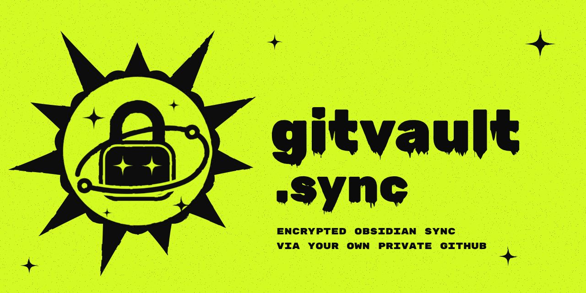

# Gitvault Sync

Sync your Obsidian vault across desktop and mobile devices through **your own private GitHub repository**. Everything is encrypted on the device with your password — GitHub only ever sees ciphertext.

> **Beta.** Back up your vault before the first sync.

## Why

- **Your storage, no middleman.** No third-party server and no subscription — only your GitHub account.
- **End-to-end encrypted.** File contents *and* file names are encrypted (AES-256-GCM, key from your password via PBKDF2 + HKDF).
- **Nothing silently lost.** Every write is conditional, so two devices can never overwrite each other. Edits to different parts of a note merge automatically; clashing edits keep both versions — yours is saved next to the original as `Note (conflict iPhone 2026-10-27 1130).md`.
- **Fast.** Only changed files are transferred; changes reach other open devices within seconds.
- **Safety nets.** Asks before deleting many files, never treats an empty repo as "delete everything", never overwrites a note you're typing in.
- **Full history for free** — it's a git repository.

## Setup

1. Install **Gitvault Sync** from **Settings → Community plugins → Browse** and enable it. (Manual install: copy `main.js`, `manifest.json`, `styles.css` from the [latest release](../../releases) into `<vault>/.obsidian/plugins/gitvault-sync/`.)
2. In the plugin settings press **Sign in** and confirm the one-time code on GitHub. The plugin picks the path itself:
   - **first device** — it walks you through creating an empty **private** repository and giving the Gitvault Sync GitHub App access to *that repository only*, then you set a password;
   - **any other device** — it finds the existing vault and only asks for the same password.

Sync then runs automatically while Obsidian is open. Commands: *Sync now*, *Pause/resume sync*, *Show sync status*. The interface follows Obsidian's language (English or Russian).

**If you lose the password, the data on GitHub cannot be decrypted.** Your local files are not affected.

## Good to know

- Syncing `.obsidian` settings and plugins is optional (off by default).
- Files over 50 MB are skipped; GitHub works best with repositories under ~1 GB — the plugin warns at 700 MB.
- Mobile apps can't sync in the background — syncing happens while Obsidian is open.

## Disclosures

- **Account:** requires a GitHub account.
- **Network:** talks only to `api.github.com` and `github.com` (sign-in, your repository). No telemetry.
- **Access:** the GitHub App can read and write only the repositories you select when installing it. The access token and password are stored only on your device, never in the vault or the repository.

## Docs

Detailed guide in Russian: [docs/README.ru.md](docs/README.ru.md).

## License

[MIT](LICENSE). Portions adapted from [Obsyncian](https://github.com/aabulkhairov/obsyncian) (MIT) — see [NOTICE](NOTICE).
